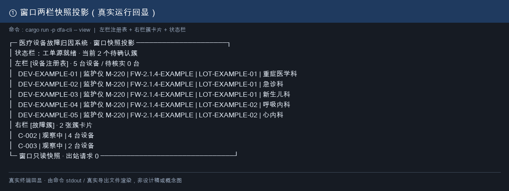
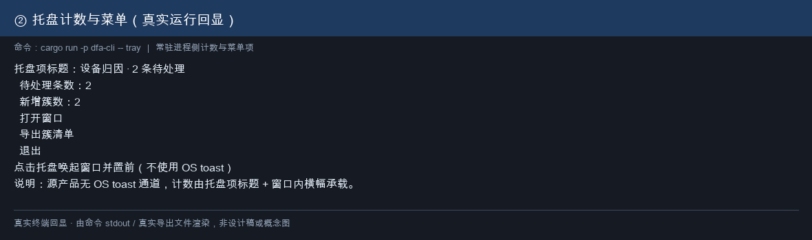
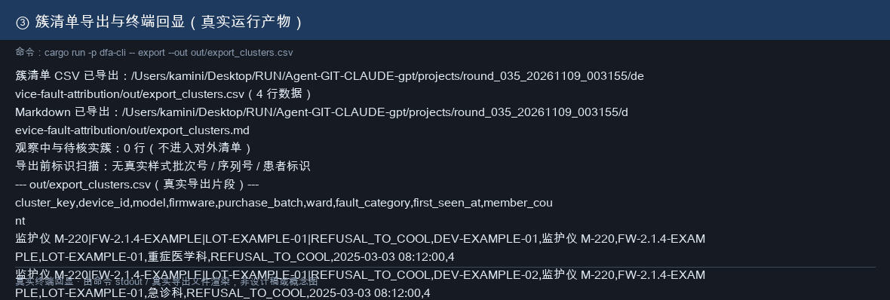
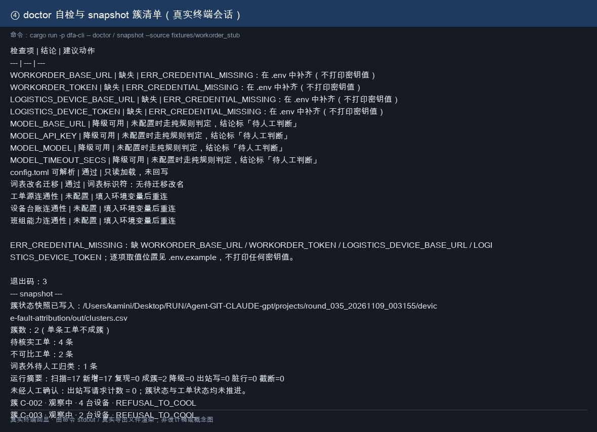

# 医疗设备故障归因系统

> 设备科把新的故障工单丢进常驻的桌面小工具，它当场算出「这批机器是不是出的同一个毛病」并排出先查哪几步；工程师点一次确认，系统批量开出工单写回工单系统，同时导出一份能带去周例会、也能给厂商看的同批设备故障清单。

面向医院设备科 / 生物医学工程部值班工程师的桌面常驻小工具（窗口 + 系统托盘）。设备身份以**设备台账**为准，故障现象以**故障工单**为准；系统把两路数据按型号、固件版本、到货批次对齐后，判断新故障是不是**同源**（同一批次同一毛病），给出根因假设草稿与按「先查哪一步最可能证伪」排序的核查步骤，并把人工确认后的工单批量写回工单系统。

---

## 适用场景 / 目标岗位

| 岗位 | 什么时候用 | 得到什么 |
|------|------------|----------|
| 设备科值班工程师 | 交班时或工单刚进来，想知道是不是老毛病又犯了 | 一句话结论：这批机器疑似同一个毛病，受影响的是哪几台，先查哪几步 |
| 设备科工程师（复核） | 每轮巡检刷完，队列里堆了几条待判断的同源线索 | 一张簇卡片：涉及哪几台机器、固件和批次对不对得上、根因假设草稿、核查步骤排序 |
| 设备科主管 | 打算批量开单之前，想先确认这批单子开得对不对 | 一次确认动作 → 批量建单 → 每张开单的回执逐条可见 → 一份可带走的簇清单 |
| 设备科台账维护岗 | 台账里设备信息不全，导致设备无法被归组 | 一份「待核实」清单：哪几台缺哪个字段，补齐后自动重新纳入 |

---

## 能力要点

- **当场判断同源，不靠人工翻台账**：新故障工单进来时，系统自动按型号、固件版本、到货批次与故障描述对齐，给出「疑似第 N 个同源簇、含 N 台设备」的结论，替代人工逐条比对型号固件批次。
- **缺信息就说缺信息，绝不猜**：设备台账里序列号缺失的设备标「待核实」，不参与同源判定、不生成工单；固件或到货批次缺失时该条判「不可比」并列出缺哪个字段，不拿默认值凑数。
- **核查步骤按「先查哪一步最可能证伪」排序**：把设备停机影响面（是否在监护、手术等关键岗位）与班组当前处置能力一起算进排序，给出的处置项一定在当次重取的班组能力范围内。
- **根因假设必须引用簇内证据**：模型给出的每条根因假设都要指认具体是哪台机器、哪个固件版本、哪个批次；指认不存在的证据会被直接驳回并留痕。
- **不确认就不写出去**：未经人工确认，出站请求数恒为 0，簇状态与工单状态一律不变；模型产出全部是草稿，模型不可达时降级为纯规则判定并标注「规则判定 · 待人工判断」。
- **批量开单单条失败不中断**：一次确认批量开单，每张开单各有回执（成功 / 失败 / 可重放）；失败的那条可以单独重放，重放复用同一幂等键，不会开出第二张重复单。
- **带走的是能用的材料**：簇清单可导出 CSV / Markdown，含同批设备的故障时间线、批次、固件、科室与停机处置，是周例会材料和厂商对接材料的原始底稿。

---

## 快速开始

### 依赖

- Rust 工具链 ≥ 1.75（edition 2021）
- SQLite（由 `rusqlite` 的 `bundled` 特性随二进制一起编译，无需单独安装）
- 出站访问院内工单系统与设备台账的网络可达性（仅在接入真实环境时需要）

### 安装

```bash
# 克隆后进入项目目录
cd device-fault-attribution

# 编译（开发模式）
cargo build

# 编译发布版（设备科工位部署用）
cargo build --release
```

### 配置

凭据与策略分离：**凭据一律走环境变量，策略走 `config.toml`**，两者都不写死在代码里。

```bash
# 复制环境变量清单并按院内实际填写（.env 已被 .gitignore 排除）
cp .env.example .env
```

```bash
# 或者直接由运维注入系统环境变量
export WORKORDER_BASE_URL="https://his.example-hospital.local"
export WORKORDER_TOKEN="<工单系统签发的令牌>"
export LOGISTICS_DEVICE_BASE_URL="https://logistics.example-hospital.local"
export LOGISTICS_DEVICE_TOKEN="<设备台账令牌>"
export MODEL_BASE_URL="http://10.0.0.9:8000/v1"
export MODEL_API_KEY="<模型服务令牌>"
export MODEL_MODEL="qwen2.5-instruct"
export MODEL_TIMEOUT_SECS="30"
```

### 构建与验证

```bash
cargo fetch                     # 安装：取依赖（断网设 DFA_OFFLINE=1 自动跳过）
cargo build --workspace         # 安装：构建 11 个 crate
cp .env.example .env            # 配置：凭据键位，真实值由运维注入
bash scripts/verify.sh          # 使用 + 验证：四段一键入口
cargo test --workspace          # 验证：verify.sh 第 4 段执行的同一条命令
```

`bash scripts/verify.sh` 依次跑完安装、配置、doctor / snapshot / confirm / export 与全量测试；断网时用 `DFA_OFFLINE=1 bash scripts/verify.sh`。参数细节见 `docs/cli.md`，回显样例见 `docs/examples.md`，架构与审计链见 `docs/architecture.md`。

### 主命令速查

```bash
cargo run -p dfa-cli -- doctor      # 自检：凭据齐备性、配置可解析性、三个源连通性，输出可粘贴进工单的清单
cargo run -p dfa-cli -- snapshot    # 只读导出当前簇状态（簇号 / 成员 / 类别 / 证据 / 状态）
cargo run -p dfa-cli -- replay      # 离线重放：按簇拉出可重放的失败项，复用原幂等键重投
cargo run -p dfa-desktop            # 启动常驻小工具（窗口 + 系统托盘）
```

---

## 命令 / API / 配置说明

### 关键配置项

| 配置项 | 默认值 | 说明 |
|--------|--------|------|
| `WORKORDER_BASE_URL` | 无（必填） | 工单系统基地址；同时用于故障工单入站读、班组能力入站读与工单出站写 |
| `WORKORDER_TOKEN` | 无（必填） | 工单系统访问令牌，以 `Authorization: Bearer` 出站；不出现在日志与回执中 |
| `LOGISTICS_DEVICE_BASE_URL` | 无（必填） | 设备台账基地址，设备身份真源 |
| `LOGISTICS_DEVICE_TOKEN` | 无（必填） | 设备台账访问令牌，以 `Authorization: Bearer` 出站 |
| `MODEL_BASE_URL` | 无（可留空降级） | 兼容 OpenAI Chat Completions 的模型服务基地址；院内部署端点可用 |
| `MODEL_API_KEY` | 无（可留空） | 模型服务令牌；不落库、不进日志 |
| `MODEL_MODEL` | 无（可留空降级） | 模型名；留空时系统走纯规则判定并标注降级 |
| `MODEL_TIMEOUT_SECS` | `30` | 单次模型调用超时（秒），超时后重试 ≤2 次再降级 |
| `config.toml` | 随仓库提供骨架 | 只读策略文件：同源硬约束、派单规则、故障类别词表、别名表、班组能力覆盖、确认预算 |

### CLI 子命令 / 接口端点

| 命令或路径 | 用途 | 关键参数 |
|------------|------|----------|
| `dfa-cli doctor` | 环境与连通性自检，输出「检查项 / 结论 / 建议动作」结构化清单 | 每次调用 5 秒硬上限；超时与断连返回可区分错误码 |
| `dfa-cli snapshot` | 只读导出当前簇状态到 stdout 与文件，不改任何状态 | `--out <路径>` 指定导出文件 |
| `dfa-cli replay` | 离线重放可重放的失败建单项，复用原幂等键 | `--cluster <簇号>` 指定簇；已成功项不重复提交 |
| `GET {LOGISTICS_DEVICE_BASE_URL}/api/v1/devices` | 读设备台账（设备身份真源，只读） | `Authorization: Bearer $LOGISTICS_DEVICE_TOKEN`；支持分页 / 游标遍历 |
| `GET {WORKORDER_BASE_URL}/api/v1/work-orders?status=open` | 读未闭环故障工单（只读） | `Authorization: Bearer $WORKORDER_TOKEN` |
| `GET {WORKORDER_BASE_URL}/api/v1/teams?capability={cap}` | 读班组能力（每次建单前重取，不缓存） | `Authorization: Bearer $WORKORDER_TOKEN`；取不到即禁止建单 |
| `POST {WORKORDER_BASE_URL}/api/v1/work-orders` | **批量建单（本产品改变真实业务状态的落点）** | `Authorization: Bearer $WORKORDER_TOKEN` + `Idempotency-Key: sha256(cluster_id\|workorder_no)`；body 含 10 个字段：`workorder_no` / `device_id` / `device_model` / `firmware_version` / `fault_code` / `fault_text` / `priority` / `assignee_team` / `source_ref` / `cluster_id` |

### 错误与降级

| 场景 | 表现 | 处理方式 |
|------|------|----------|
| 模型服务不可达 / 超时 / 返回不可解析 / 结构校验不符 | 结果标「规则判定 · 待人工判断」，簇与工单状态不推进 | 退避重试 ≤2 次后降级为纯规则判定，降级次数与原因写运行摘要与审计链 |
| 工单源不可用 | 窗口状态栏显示「工单源不可用」，**不显示「无故障」** | 就绪三值传播到窗口；空列表与源不可用严格区分，并提供重试入口 |
| 设备序列号缺失 / 型号冲突 | 该设备标「待核实」，不出现在任何簇里 | 待核实清单按缺失字段分组，界面单列展示并给补录引导；绝不按科室或型号猜身份 |
| 固件版本或到货批次缺失 | 该条判「不可比」并列出缺失字段名 | 不参与同源判定、不并簇；提示设备科去台账补齐 |
| 故障描述落在受控词表外 | 标「待人工归类」，拒绝建单 | 不静默新建类别；被拒项落审计链并在界面可见 |
| 班组能力表取不到或缺项 | 建单被拒，出站写请求数为 0 | 每次建单前重取能力，绝不用上一次的结果顶替 |
| 批量建单中单条失败 | 其余单照常开出，逐条回执分别标注成功 / 失败 / 可重放 | 失败项标可重放，重放复用同一幂等键，不产生第二张单 |
| 同键重复提交 | 对方系统只应收到一张单 | 幂等键与时间戳、重试次数无关；本地提交账本同时保证只留一条生效记录 |

### 对接现有系统

本产品与院内系统之间只有 **3 路入站读 + 1 路出站写**，全部为 REST：

- **入站读**：设备台账（设备身份真源）、未闭环故障工单（故障现象真源）、班组能力（派单可行性）。
- **出站写**：批量创建故障工单，请求头带 `Idempotency-Key`，请求体字段与枚举约束按上面的字段表逐项校验后才发出。
- **凭据来源**：全部取自上表的环境变量；`.env` 已被 `.gitignore` 排除，代码不硬编码、不写日志、不入库。
- **不触碰患者数据**：只处理设备级与工单级字段；工单自由文本里若混入姓名、住院号、手机号等可识别片段，落库前剥离并留审计。

**院内真实端点的接入状态**：本产品已落**正式对接规范（字段表 + 幂等约定 + 错误码）+ 真实出站客户端 + 环境变量凭据位**；院内工单系统与设备台账的真实端点需在设备科工位按上表填入环境变量后接通。端到端契约测试使用本地协议替身，**替身只在测试数据层，不是最终对接方式**。

---

## 典型场景

### 场景 1：设备科值班工程师交班时判断「是不是老毛病又犯了」

1. 工单系统里进来一张新的故障工单（某型号监护仪，描述「不制冷」）。
2. 系统按型号、固件版本、到货批次对齐后，发现同批次另有 2 台也报了同一现象，形成一个待确认簇。
3. 值班工程师在窗口里看到簇卡片与排好序的核查步骤，点「仅存观察」暂不开单，或直接进入场景 2。

```bash
# 只想先看一眼当前有多少簇、分别是什么（只读，不改状态）
cargo run -p dfa-cli -- snapshot
```

### 场景 2：设备科主管确认后批量开单并回写工单系统

1. 工程师在簇卡片里选定成员，填故障类别、优先级、建议班组，勾选「确认并批量开单」。
2. 系统在出站前逐条校验（类别在受控词表内、优先级合法、班组在当次重取的能力表内），不通过的当场列出缺项并拦下。
3. 逐条建单完成，界面按条给出回执；其中 1 条失败的标为可重放，可单独重放。

```bash
# 确认前先做一次环境自检，把结果贴进工单
cargo run -p dfa-cli -- doctor

# 事后把失败项重投（复用原幂等键，不会开出重复单）
cargo run -p dfa-cli -- replay --cluster C-007
```

### 场景 3：周例会前导出同批设备故障清单

1. 例会前需要一份「这批设备到底是不是集体出事」的材料。
2. 从窗口或 CLI 导出簇清单，含簇号、成员设备、型号、固件、到货批次、科室、故障类别、首次出现时间、成员数。
3. 该清单可直接进周例会材料，也可作为与厂商交涉的原始材料（院内履行器械不良事件报告义务时仍由医务 / 器械管理岗按流程提交）。

```bash
# 导出簇清单（CSV），供例会与厂商材料使用
cargo run -p dfa-cli -- snapshot --out out/clusters.csv
```

---

## 输出样例

### 簇清单 CSV

```csv
cluster_id,device_id,device_model,firmware,purchase_batch,ward,fault_category,first_seen_at,member_count
C-007,DEV-0417,监护仪 M-220,v2.1.4,B2023Q4-07,重症医学科,REFUSAL_TO_COOL,2026-03-04 08:12:00,3
C-007,DEV-0431,监护仪 M-220,v2.1.4,B2023Q4-07,急诊科,REFUSAL_TO_COOL,2026-03-04 09:35:00,3
C-007,DEV-0455,监护仪 M-220,v2.1.4,B2023Q4-07,新生儿科,REFUSAL_TO_COOL,2026-03-05 07:02:00,3
```

### CLI doctor 输出

```text
检查项 | 结论 | 建议动作
--- | --- | ---
WORKORDER_TOKEN | 缺失 | ERR_CREDENTIAL_MISSING：在 .env 中补齐（不打印密钥值）
config.toml 可解析 | 通过 | 只读加载，未回写
词表改名迁移 | 通过 | 词表标识符：无待迁移改名
工单源连通性 | 未配置 | 填入环境变量后重连
```

### 窗口簇卡片

簇卡片字段：簇号、状态（观察中 / 已确认同源 / 已开单 / 已闭环）、成员数、成员表格（设备号 / 型号 / 固件 / 到货批次 / 科室 / 故障描述）、证据字段、根因假设草稿（标「草稿 · 待人工确认」）、核查步骤有序列表、底部「确认并批量开单」与「仅存观察」两个动作。

---

## 概念 / 实测对照

### 视觉目标

`docs/concepts/visual-target.md` 是本产品的**结构化视觉目标卡**：起始态 / 首个可用瞬间 / 成形态三个画面，配色（主色深蓝 `#1F3A5F`、状态色绿 `#2E7D32` / 橙 `#E07B00` / 红 `#C62828`）、字体层级（正文系统无衬线，设备号与固件版本等宽右对齐）、信息密度（卡片内边距 16px、行高 28px）与必须可达的约束。

本运行环境无图像生成能力，故**只保留结构化卡片，不伪造概念图**。

### 实测证据

以下 4 张均为**真实运行产物**：命令 stdout 或真实导出文件渲染出的终端回显位图，不是设计稿、不是概念图。






**目标与实测的差距**：本环境无显示服务，无法采集 OS 原生窗口与托盘图标的像素，故 ① 是 `dfa-cli view` 的两栏文本投影、② 是 `dfa-cli tray` 的菜单回显；交互只在计数与文本投影层面体现，视觉目标卡中的配色过渡、卡片内边距与图标细节未在截图中呈现。院内工单系统与设备台账的真实端点本轮不可得，截图中的工单号与批次号均为占位标识；接入条件见「### 对接现有系统」。

> **诚实标注**：上侧为**视觉目标**（设计意图），下侧为**实测证据**（真实运行产物）。两者在布局密度、图标细节与颜色过渡上必然存在差距 —— 以实测为准，不声称两者完全一致，也不会用事后效果图抹平差距。

---

## 架构与数据流

```
入站三路（只读 · Bearer 凭据取自环境变量）
  设备台账 GET /devices     ─┐
  故障工单 GET /work-orders ─┼─► dfa-ingest（就绪三值 / 扇入去重 / 退避 / 生命周期）
  班组能力 GET /teams      ─┘              │
                                           ▼
                    dfa-registry（序列号 + 型号双因子 · 歧义拒绝 → 待核实）
                                           │
                                           ▼
   dfa-cluster 差分三态 → 硬约束门 → 词表精确 → 别名回退 → 同源成簇
   dfa-attribution 语义判定 / 根因草稿 / 步骤排序 / 规则守门
   dfa-model 单一 OpenAI-compatible 网关（不可达即降级纯规则）
                                           │ 人工确认（唯一推进者）
                                           ▼
   dfa-workorder（写前校验 → 幂等键 → 逐条 POST → 逐条回执）
                                           │
                                           ▼
   dfa-store（SQLite · 只增不改审计链 · 快照原子写）
                        ┌──────────────────┴──────────────────┐
                        ▼                                     ▼
            dfa-desktop 窗口（只读快照）            dfa-cli doctor / snapshot / replay
            + 系统托盘计数与横幅                    （每次调用 5 秒硬上限）
```

### 关键不变量

- **人工确认是唯一推进者**：未经确认，出站写请求数恒为 0，簇状态与工单状态不发生任何变化；模型产出恒为草稿。
- **读不到 ≠ 不在**：源不可用与字段缺失一律记为未知（不可用 / 不可比），不会静默变成「没有故障」或「设备不在」，也不会被默认值兜底。
- **幂等键与时间无关**：`sha256(cluster_id‖workorder_no)` 对同一对输入恒定，重试与重放复用同一键，不会开出第二张单。
- **失败不静默**：单条建单失败不中断同批，失败项显式标为可重放并落库；模型降级、源不可用、词表外类别全部留痕在审计链。
- **配置与注册表只读**：策略文件与设备台账只读不回写，本产品不向院内系统反向修改任何主数据。

---

## 安全与合规边界

- 模型输出的一切（故障类别、同源判断、根因假设、核查步骤、建议班组）**均为草稿**，只有人工确认动作才产生写操作；模型不产出诊断、治疗建议或不良事件结论。
- 本产品**不代填、不代报**院内不良事件与召回报告，报告仍由医务 / 器械管理岗按院内流程提交；产品只提供原始材料整理。
- 只处理设备级与工单级字段，工单自由文本中的患者可识别片段在落库前剥离；产品不触碰患者数据，也不与 HIS / EMR 相邻。
- 凭据只从环境变量读取，不硬编码、不写日志、不入库；审计链只增不改，可回答「这张工单当时为何被并进这个簇」。

---

## 验收与自检

| 验收项 | 命令 | 期望结果 |
|--------|------|----------|
| 全量测试通过 | `cargo test --workspace` | 全部用例通过，退出码 0 |
| 簇清单可导出 | `cargo run -p dfa-cli -- snapshot --out out/clusters.csv` | 生成 `out/clusters.csv`，含簇号 / 成员 / 证据 / 类别列 |
| 环境自检可用 | `cargo run -p dfa-cli -- doctor` | 输出「检查项 / 结论 / 建议动作」清单，5 秒内返回 |
| 未确认不写出去 | 未点确认时运行一轮 | 出站写请求计数为 0，簇状态 diff 为 0 |
| 幂等键稳定 | 对同一簇与同一工单多次计算 | 结果恒定，且与时间戳、重试次数无关 |
| 缺失字段不兜底 | 设备缺固件或批次时成簇 | 判「不可比」并列出缺失字段名，该条不并簇 |
| 文档骨架完整 | `bash scripts/verify.sh` | 安装 / 配置 / 使用 / 验证四段依次执行并给出结果 |

---

## 项目结构

```
device-fault-attribution/
├── Cargo.toml / Cargo.lock         # workspace 定义（11 个 crate）与依赖锁定
├── README.md / LICENSE / qrcode.jpg
├── .env.example / config.toml / .gitignore   # 凭据键位 / 只读策略 / 排除规则
├── docs/
│   ├── concepts/visual-target.md   # 结构化视觉目标卡（起始态 / 首个可用瞬间 / 成形态）
│   ├── screenshots/                # 4 张真实运行截图（终端回显 / 托盘 / 导出片段）
│   ├── cli.md / examples.md / architecture.md   # 参数参考 / 回显样例 / 架构与审计链
│   └── clustering-benchmark.md / scale-metrics.md   # 基线对比 / 千条规模度量
├── fixtures/                       # 脱敏样例集（仅测试数据层，不是最终对接面）
│   └── workorder_stub/             # 本地协议替身：10 字段校验 / 幂等 / 5xx 注入
├── scripts/                        # verify.sh + 公开数据 / 语料 / 评测 / 度量 / 截图脚本
├── corpus/                         # 离线评测与规模语料（由 scripts/ 可重复生成）
└── crates/                         # 11 个 crate，依赖方向自上而下
    ├── dfa-core/                   # 领域类型、三值在场性、簇状态机、受控词表、确定性内核
    ├── dfa-config/                 # 只读 TOML、硬约束求值、改名迁移检测、三层叠加
    ├── dfa-store/                  # SQLite 迁移、只增不改审计链、快照原子读写、PII 剥离
    ├── dfa-ingest/                 # 三路入站、分页容忍、能力每次重取、就绪三值、生命周期
    ├── dfa-registry/               # 权威注册表、双因子绑定、歧义拒绝、待核实队列
    ├── dfa-cluster/                # 差分三态、确认预算、同源成簇、幂等与重放、规模度量
    ├── dfa-attribution/            # 归并三级链路、同源三值判定、根因证据校验、步骤排序、降级
    ├── dfa-model/                  # 单一 OpenAI-compatible 网关、schema 校验、错误分类
    ├── dfa-workorder/              # 写前校验、幂等键、逐条回执、退避重放
    ├── dfa-desktop/                # 设计 token、两栏窗口、簇卡片、三态、响应式、托盘
    └── dfa-cli/                    # doctor / snapshot / replay / export / confirm / view / tray
```

---

## License

MIT

---

## 关注我们

欢迎扫码关注公众号，获取项目更新与交流加群：

